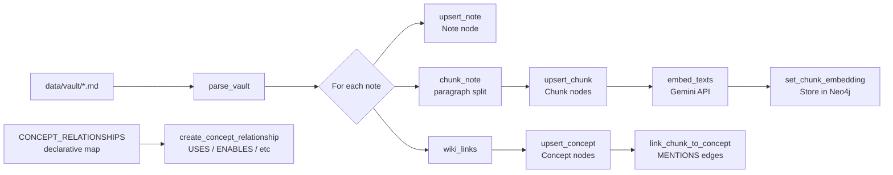
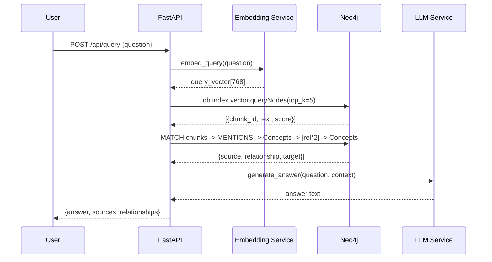

# Architecture

## System Overview

```mermaid
flowchart TD
    A[Obsidian Vault\n*.md files] --> B[Markdown Parser\npython-frontmatter + regex]
    B --> C[Chunker\nparagraph-based]
    B --> D[Wiki-Link Extractor\n[[Concept]] patterns]
    C --> E[Gemini Embeddings\ngemini-embedding-001\n768 dims]
    E --> F[Neo4j Vector Index\nchunk_embedding_index\ncosine similarity]
    D --> G[Neo4j Knowledge Graph\nConcepts + Relationships]
    F --> H[GraphRAG Retriever]
    G --> H
    H --> I[Context Builder\nChunks + Graph Relations]
    I --> J[Gemini LLM\ngemini-2.0-flash]
    J --> K[FastAPI\nREST API]
    K --> L[Streamlit\nChat UI]
```

---

## Ingestion Pipeline



---

## Graph Schema

### Node Types

| Label | Key Properties | Description |
|---|---|---|
| `Note` | `id, title, filename, content, project` | Markdown file |
| `Chunk` | `id, text, embedding, chunk_index, note_id, project` | Text chunk |
| `Concept` | `id, name, type, project` | Named concept |

### Relationship Types

| Type | Between | Meaning |
|---|---|---|
| `HAS_CHUNK` | Note → Chunk | Note contains this chunk |
| `MENTIONS` | Chunk → Concept | Chunk text references concept |
| `LINKS_TO` | Note → Note | Obsidian wiki-link |
| `USES` | Concept → Concept | Source uses target |
| `ENABLES` | Concept → Concept | Source enables target |
| `DEPENDS_ON` | Concept → Concept | Source depends on target |
| `RELATED_TO` | Concept → Concept | General relationship |
| `EXTENDS` | Concept → Concept | Source extends/builds on target |
| `IMPLEMENTS` | Concept → Concept | Source implements target |
| `BUILT_WITH` | Concept → Concept | Source is built with target |
| `PREREQUISITE_OF` | Concept → Concept | Source is a prerequisite |
| `STORES` | Concept → Concept | Source stores target |
| `PROVIDES` | Concept → Concept | Source provides target |
| `CONTAINS` | Concept → Concept | Source contains target |
| `HAS_CONSTRAINT` | Concept → Concept | Source has this constraint |
| `SUPPORTS` | Concept → Concept | Source supports target |
| `SENT_TO` | Concept → Concept | Source is sent to target |

---

## Vector Retrieval



---

## GraphRAG Retrieval Path

```
User Question
     │
     ▼
Gemini embed_query()         ← RETRIEVAL_QUERY task type
     │
     ▼
Neo4j Vector Index Search    ← cosine similarity, top-K chunks
     │
     ▼
Top-K Chunks                 ← entry points into knowledge graph
     │
     ├─ chunk.text           ← semantic content
     └─ MENTIONS → Concepts  ← graph entry points
           │
           ▼
     Graph Traversal         ← 1-2 hops from each concept
           │
           ▼
     Related Concepts        ← concept-to-concept relationships
     + Relationship Types
           │
           ▼
     Context Builder         ← "RETRIEVED DOCUMENTS\n..." + "GRAPH RELATIONSHIPS\n..."
           │
           ▼
     Gemini LLM              ← grounded generation with system prompt
           │
           ▼
     Answer + Sources + Graph Context
```

---

## API Architecture

```
GET  /health                → HealthResponse
POST /api/query             → QueryResponse (answer + sources + relationships)
POST /api/ingest            → IngestResponse (stats)
GET  /api/sources           → list[NoteInfo]
GET  /api/graph/{concept}   → GraphExploreResponse (neighbours)
GET  /api/stats             → StatsResponse (counts + index status)
```

---

## Frontend Architecture

```
Streamlit App (port 8501)
├── Sidebar
│   ├── Backend health indicator
│   ├── Knowledge base stats (metrics)
│   ├── Ingest button
│   └── Graph explorer (concept input)
└── Main
    ├── Example question buttons
    └── Chat interface
        ├── st.chat_message (user)
        ├── st.chat_message (assistant)
        │   ├── Answer (markdown)
        │   ├── Sources expander
        │   └── Graph relationships expander
        └── st.chat_input
```

All API calls go through `httpx` to `http://localhost:8000`. No retrieval logic lives in the frontend.
